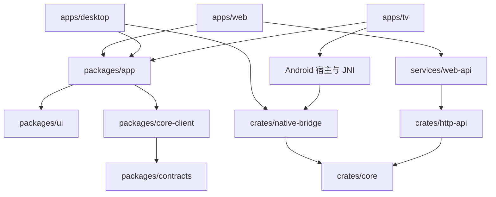

# 多端工程架构

> 2026-11-13 实施状态：pnpm/Cargo 工作区、三端薄入口、共享 UI、Axum/Tokio 和匿名官网目录服务已落地（第一阶段基线）。当前业务仍经 HTTP 连接 Rust；原生业务 bridge、完整内容协议、原生独立包和真机发行仍为目标。实际可执行命令以 README.md 为准，验证结果以 VALIDATION.md 为准。

状态：设计提案，2026-11-13。本文描述目标结构；新工作区已进入第一阶段实施，旧 `app/ + scripts/ + upstream/` 保留为行为对照，已验证边界见 [VALIDATION.md](VALIDATION.md)。工具链、Git、CI 与发布规范见 [ENGINEERING.md](ENGINEERING.md)。

## 1. 核心决策

采用一个仓库、pnpm 与 Cargo 两套工作区、三个产品入口。NSH TSX 负责界面，Rust 实现内容核心、账号、媒体处理、持久化与服务端。目标产品及其正常开发、CI、发布链路均不依赖 Go。

| 决策       | 方案                                                      | 原因                                                  |
| ---------- | --------------------------------------------------------- | ----------------------------------------------------- |
| 产品入口   | Web、Desktop、Android TV 分开装配与打包                   | 部署、权限、输入和宿主生命周期不同                    |
| 页面与业务 | 共享 NSH TSX、导航、状态、播放流程                        | 同一功能保持一致，只适配必要差异                      |
| 原生能力   | Rust bridge；桌面使用 NSH mixed；TV 使用 Android 嵌入宿主 | 原生宿主调用同一 Rust library，管理生命周期与平台能力 |
| 内容核心   | 共享 Rust library，按行为重写原核心                       | 三端共享协议、账号、媒体和存储实现                    |
| HTTP 服务  | Rust HTTP 适配层 + Rust Web API 入口                      | Web 与原生端调用同一套核心用例                        |
| 包管理     | pnpm workspace、Cargo workspace                           | 两份依赖图及各自锁文件                                |
| 任务编排   | pnpm scripts 调用统一 Node 工程脚本及语言原生命令         | 本地、Agent、CI 使用相同入口                          |
| 构建缓存   | pnpm store、Cargo 原生缓存                                | 当前规模不引入额外任务缓存层；出现可测瓶颈再评估      |

Rust 核心拥有内容、账号和持久数据；TSX 拥有页面草稿、导航与显示状态。桌面和 TV 将核心链接进宿主，不再设计核心 sidecar、子进程握手或 Go mobile binding。页面与设计系统继续遵守 [DESIGN.md](DESIGN.md)。

## 2. 目标目录

下面是目标目录，不要求一次创建所有空工程。按第 9 节顺序建立真实可运行的成员。

```text
apps/
  web/                        # @hongguo/web：NSH TSX 浏览器入口
    App.tsx
    nsh.json
    tsconfig.json
    package.json
  desktop/                    # @hongguo/desktop：macOS / Windows / Linux
    App.tsx
    nsh.json
    native/                   # Cargo 成员；NSH mixed 原生导出
      Cargo.toml
      src/lib.rs
    package.json
  tv/                         # @hongguo/tv：Android TV 产品入口
    App.tsx
    nsh.json
    android/                  # Android 宿主、Gradle Wrapper、TV manifest、JNI
    package.json
packages/
  app/                        # @hongguo/app：页面、导航、状态、播放用例
    src/
    test/
  ui/                         # @hongguo/ui：控件、主题、动效、输入反馈
    src/
    theme.json
  core-client/                # @hongguo/core-client：统一接口、Web HTTP adapter
    src/
  contracts/                  # @hongguo/contracts：生成的 TS wire types
    src/
crates/
  core/                       # 协议、账号、媒体、存储；不依赖 NSH/Android
    src/
      protocol/
      account/
      catalog/
      playback/
      media/
      storage/
  http-api/                   # HTTP/媒体 Range 适配；调用同一 core
  native-bridge/              # NSH 原生 API、会话与资源生命周期
services/
  web-api/                    # Rust binary：Web 会话、HTTP 服务与核心装配
    Cargo.toml
    src/main.rs
contracts/
  core-api.openapi.json       # 从 Rust HTTP DTO/路由导出的契约
  fixtures/                  # 无真实账号数据的跨语言契约样本
tooling/                      # @hongguo/tooling；Node 工程代码，不进入 UI bundle
  src/                        # setup、doctor、dev、target registry、发布编排
  test/
upstream/
  hongguo/                    # 迁移期只读行为参考；退出后移出正常构建
docs/
  adr/                        # 重大决策的原因、约束、替代方案与验收证据
  runbooks/                   # 构建、故障排查、发布与回滚
.github/
  workflows/
  PULL_REQUEST_TEMPLATE.md
pnpm-workspace.yaml
pnpm-lock.yaml
package.json
Cargo.toml
Cargo.lock
rust-toolchain.toml
.nsh-version
.node-version
lefthook.yml
commitlint.config.mjs
.oxlintrc.json
.oxfmtrc.json
deny.toml
```

根级 `pnpm-workspace.yaml` 显式列出 `apps/*`、`packages/*` 和 `tooling`。Rust crate 不为加入 pnpm 而伪造 npm 包；统一脚本负责调用 Cargo。

实际创建的 `apps/*/native`、`crates/*`、`services/web-api` 加入根 Cargo workspace，共享一份锁文件。NSH mixed 模板自带的嵌套空 `[workspace]` 在迁入时需要移除；检查 CLI 生成的 runner 是否正确使用根锁文件，不能仅凭 `cargo metadata` 就判定宿主打包兼容。

`core` 首期按模块组织，不为每项功能建立微服务或独立 crate。HTTP 与原生桥接分别是外层适配器，不能把核心绑定到某个入口、NSH 引擎或 HTTP 框架。

异步 runtime 由宿主/服务统一管理，核心会话复用执行上下文；网络、数据库与媒体解析不阻塞 UI 线程。账号上下文可以有多个，但不能每个会话都创建一套不受控的线程/runtime。

## 3. 依赖方向



图中 App/UI/Client 是源码依赖，Web → API 是网络调用，原生桥接 → Core 是进程内 Rust 调用。原生视频需要 URL 时，可由宿主启用同一 HTTP 适配层的本机媒体路由；业务调用不必绕回 HTTP。

- 应用入口只负责 `mount`、平台装配和配置注入。共享包不反向导入 `apps/*`，不在模块顶层启动宿主或执行 `mount`。
- `ui` 只包含展示与交互语义，不请求业务接口；`core-client` 定义平台无关接口及 Web HTTP adapter，不依赖 NSH、Node 或原生宿主。原生 adapter 在应用装配层实现。
- `contracts` 是 wire DTO，不包含 UI 状态或接口实现。页面状态留在 `app`，公共领域类型优先从契约映射而来。
- 内部 TS 依赖使用 `workspace:*`，通过 `exports` 暴露有限的源码入口。禁止跨包直接导入其他包的 `src/` 深层文件。
- Node 内置模块只允许出现在 `tooling`；NSH 的 `nsh/*` 和原生导出只出现在对应的 UI/宿主适配层。
- 用 Oxlint 导入约束和架构检查固化依赖方向。CI 要有反例用例，确认违规导入确实失败。

不把 pnpm 安装成功当成 NSH 运行时兼容证据。普通 npm 包即使能够解析，也仍需验证 QuickJS、无 DOM 环境及 NSH hardening；不能引入 React/Vite 来编译共享 UI。

## 4. 三端装配

共享应用接受一个 `AppServices` 依赖集合，最初只包含实际需要的 `coreClient` 与 `host` 能力。Web 注入 HTTP adapter，桌面/TV 注入原生 adapter，业务接口保持一致。播放器在存在第二种实际实现时再提取统一适配接口。

`host` 以能力描述环境，例如 `input: pointer | remote`、外链/更新与媒体播放能力。TV 是产品入口，不能用 `platform.os === 'android'` 推导所有 Android 环境都是 TV。共享组件按输入模式调整尺寸与焦点，业务规则保持一致。

| 端         | UI 与输入                    | 核心位置                              | 正式宿主职责                              |
| ---------- | ---------------------------- | ------------------------------------- | ----------------------------------------- |
| Web        | 共享 TSX；键鼠/触屏          | Rust 服务端内的 core                  | 同源 API、用户会话、媒体流、部署版本      |
| Desktop    | 共享 TSX；键鼠；桌面窗口     | 宿主内链接的 Rust core                | NSH mixed、窗口、系统存储、任务停止与更新 |
| Android TV | 共享业务；遥控焦点与电视布局 | Android native library 内的 Rust core | Android/JNI 生命周期、TV 入口、原生视频   |

### Desktop

使用 NSH mixed，Rust bridge 初始化 core 的会话、存储与后台任务。页面通过有类型的原生 API 调用核心；初始化失败、账号变更、升级或用户退出均有确定行为。网络请求、播放会话与进度落盘拥有明确的取消和关闭顺序。

媒体 URL 如需本机 HTTP，监听随机 loopback 端口，仅开放所需媒体路由，保留 Host/Origin、媒体路径、会话授权与 Range 检查。URL 由核心产生，不接受任意外部 scheme/host。避免将视频字节通过 TSX/FFI 反复复制。

产品内核心与宿主共享进程，不能依靠核心子进程重启隔离故障。关键解析使用边界检查和 fuzz，取消/销毁路径可重复执行；发现必须隔离的故障后再单独评估 Rust 进程隔离。用户安装包不需要 Node 或独立核心运行环境。

### Web

浏览器仅访问同源 API 与媒体路径。Rust Web API 使用与原生端相同的 core，负责服务器用户会话、权限、超时、请求取消和媒体 Range。浏览器包不编译或携带账号密钥与内容协议签名实现。

core 必须支持实例化的账号上下文与独立存储，禁止全局可变单账号状态。服务端按经过认证的用户创建/复用核心会话，限制并发、媒体流与缓存占用。单用户自托管只分配一个上下文，多用户共享进程时依然验证会话和数据隔离。

新 Web 开发环境直接启动 Rust Web API，Node 仅负责工程编排。上线前验证同源会话、CSRF/来源检查、媒体 206、慢客户端断开、优雅停止与数据备份。原验证网关的行为测试转移到 Rust HTTP 层。

### Android TV

将同一 Rust core 编译为 Android native library，由宿主/JNI 管理初始化、回调和销毁，通过 NSH embedding/native component 对接界面与播放器。

先验证 Rust core 在 Android ABI 下的网络/TLS、存储、媒体处理及 NSH 桥接，再接完整页面。TV 核心 API 与桌面共享，平台差异限于宿主适配和能力实现。

首轮验收包括初始化/停止、后台/恢复、JNI 所有权、真实媒体解码、遥控确认/返回及焦点恢复。依赖电脑的端口反向转发不算独立 TV 验收。

初期目标是 Android TV。webOS、Tizen、tvOS 不因采用 monorepo 自动得到支持，增加时需另有宿主与发布矩阵。

## 5. 契约与跨语言边界

已实现的目录切片位于 `crates/core/src/catalog/`：Rust DTO、纯解析和可克隆 `CatalogClient`。生产固定官网 origin，HTTP/1.1、无 Cookie/代理/重定向；搜索 4 MiB、详情 12 MiB，每次 5 秒、整体 12 秒，最多两次尝试。drop 取消 pending future，核心不 spawn 脱离调用者的查询任务。loopback origin 仅由测试显式注入，API 请求不能指定上游地址。

`http-api` 将搜索/详情接入相同服务，输入错误 400、上游失败 502、超时 504；TLS/client 初始化成功后，binary 才发布 ready。状态声明 search=true、playback/account=false。目录 DTO 已由 Rust → `contracts/openapi.json` → TypeScript 生成；账号/播放兼容 DTO 与其余持久状态继续按后续阶段迁移。官网/App 的分页不同，本切片明确使用 source=web，不支持创作者合集。离线 fixtures 和 opt-in probe 说明见 `contracts/fixtures/catalog/README.md`。

游客历史切片位于 `crates/core/src/library/`：独立 SQLite application_id/user_version，bundled SQLite、WAL/FULL 与 Immediate 事务；阻塞工作在 spawn_blocking 执行，commit 后才返回快照。版本不兼容/坏库拒绝初始化，不读取旧 JSON。HTTP binary 明确接受 --data-dir，工程脚本传 .local/data/rust；存储先于 ready 初始化，history capability 由装配状态决定。账号、云同步、收藏/点赞和原生业务 bridge 仍未迁移，详见核心存储 README。

HTTP 契约由 Rust HTTP DTO 与路由导出到 `contracts/openapi.json`，建议使用 utoipa；再用固定版本的 `openapi-typescript` 生成 TS wire types。Rust DTO 是该契约的唯一编辑源，生成结果提交并在 CI 检查漂移。

原生 API 类型由 NSH 从 Rust 导出生成。原生与 HTTP adapter 映射到同一 TS `CoreClient` 接口，使用同一组契约场景验证；取消、错误码与进度语义不得因传输方式不同而漂移。

建议基础库为 Tokio、reqwest、Axum、Serde；存储先采用 rusqlite/SQLite，阻塞数据库操作使用专门执行上下文。具体版本、TLS 后端与 SQLite 打包方式经过桌面/Android 构建验证后锁定。密码学使用经过维护的库，不自行实现底层算法。

接口演进使用明确的 API/bridge 版本，至少覆盖当前与上一可支持产品版本的升级路径。未知字段、缺失字段、失败码、取消、超时、历史载荷上限、媒体路径校验和 206 响应均有契约测试。存储新格式不要求照搬上游 JSON，但需要明确、可测试的数据导入策略。

FFI/JNI 边界明确内存分配与释放方、线程、回调注销、异步取消及关闭幂等性。Rust panic 不跨 ABI 传播，panic 策略与清理路径一起验证；裸指针不进入页面状态。只有必要的 FFI 模块可以包含经审查的 `unsafe`。

## 6. 配置、数据与产物

- 配置分为提交的产品默认值、机器环境配置、每次运行的临时连接信息；不把绝对路径和随机端口写进提交文件。
- 各入口单独生成 `.nsh/` 与 `runtime.generated.json`；同一入口默认单会话。支持多会话前必须先隔离运行目录，避免并发覆盖。
- 主题与动效由 `packages/ui` 唯一维护；入口引用同一主题源。公共 NSH 包按各入口的生成类型进行检查，不提交 `.nsh/types`。
- 根编辑器配置以 Web 入口的 NSH 类型作为共享包编辑上下文；各产品入口再独立检查。生成前的缺失类型提示由 `setup` 解决，不能手写一份过时 NSH 声明。
- 开发数据仍保留在 `.local/data/`，迁移目录不等于迁移账号数据。正式数据使用平台标准私有目录；升级迁移必须有版本、备份及恢复测试。
- 缓存、临时数据、签名材料和截图不进 Git；正式产物归档到按产品版本/平台/架构区分的目录，避免覆盖前端 bundle 与完整安装包。

## 7. 现有代码迁移映射

| 当前                                   | 目标                                          | 迁移约束                                                  |
| -------------------------------------- | --------------------------------------------- | --------------------------------------------------------- |
| `app/App.tsx`                          | `packages/app` 的应用根 + `apps/*/App.tsx`    | 移除共享包中的 `mount` 副作用，保留导航行为               |
| `app/pages`、`store.ts`、`playback.ts` | `packages/app/src`                            | 先保持状态与进度写入语义，再注入依赖                      |
| `app/src/ui`、`theme.json`             | `packages/ui`                                 | 主题、焦点和动效不发生顺带重设计                          |
| `app/api.ts`                           | `packages/core-client` + `packages/contracts` | 配置由入口注入，历史裁剪与媒体检查保留                    |
| `app/*.test.tsx`                       | 共享用例与各入口测试 harness                  | 共享用例验证真实入口装配，不只测空壳                      |
| `scripts/*`                            | `tooling/src` 与 `tooling/test`               | 所有路径从明确仓库/目标根解析，不依赖调用 cwd             |
| Node 网关                              | `crates/http-api`                             | 来源、路由、请求体、Range/206、断开取消转为 Rust 行为测试 |
| `upstream/hongguo`                     | 去敏 fixtures、测试向量与来源记录             | 作为重写参考；新工程不链接、启动或编译它                  |

### Rust 核心的行为迁移

| 范围             | 原行为参考                                     | Rust 验收                                              |
| ---------------- | ---------------------------------------------- | ------------------------------------------------------ |
| 签名与设备参数   | passport/playback/minireel 签名向量            | 固定输入、时钟、随机源得到一致字节结果                 |
| 搜索与详情       | 搜索、分季、选集解析及 fixtures                | 模型、分页、错误、过时响应与选集语义                   |
| 账号             | 二维码、取消、恢复、会话；其余认证场景单独登记 | 状态机、过期、取消、账号隔离与凭据存储                 |
| 播放解析         | 播放 URL、编码回退、来源恢复                   | 同一 episode 的解析与失败/取消行为                     |
| 媒体流           | CTR 任意偏移、MP4 分片、Range/ETag、缓存       | 去敏字节向量、206/416、断流恢复与有界内存              |
| 历史与存储       | library、guest history、串行进度               | 实际播放后写入、完成状态、写盘失败不发布变更、重启恢复 |
| 云端与其他旧功能 | cloud/follow/likes 等旧测试                    | 列入功能台账，未迁移项不得宣称已支持                   |

先提取已有去敏 JSON 向量与合成媒体样本，固定来源 SHA 和预期结果，再实现 Rust；需要对照旧实现的结果只在迁移期单独采集。正常开发、CI 和发布仅消费固定样本，不执行旧语言实现。未公开的账号/媒体数据不得作为 fixtures 提交。

## 8. 已取得的设计证据

2026-11-13 在临时目录使用本机 pnpm 11.1.3、NSH 0.5.0 验证：

- `apps/web` 通过 `workspace:*` 导入 `packages/ui` 的 TSX source exports，`nsh check` 与 `nsh build` 通过。
- 共享包中的 signal 在按钮交互后从 0 更新为 1，`nsh test` 通过，确认响应式转换并未因包边界丢失。
- `nsh.json` 引用共享包主题路径成功，`nsh package --target web` 通过。

以上是最小包结构验证，不代表完整应用已经迁移，也没有验证跨包 HMR、Cargo workspace 的 NSH runner、Rust 核心、Android embedding 或三端独立安装包。Rust 工具链的本次实施验证另见 VALIDATION.md。

## 9. 实施顺序与退出条件

1. **工程与参考基线**：建立 pnpm/Cargo 工作区、实际 Rust 成员、版本/工具 bootstrap 和基础 CI；提取旧核心 fixtures 与必需行为台账。旧验证工程保持可运行，新工作区命令不要求 Go。
2. **Rust 核心闭环**：按签名/解析 → 搜索详情 → 播放媒体 → 账号与存储的依赖顺序实现；测试向量、Range、取消和进度持久化通过，再做真实接口验证。
3. **共享应用与桌面闭环**：分离 `mount`，注入统一 client；按官方 mixed 模板接入 Rust 核心。保留已有 UI 行为，真实安装包在无开发服务下可启动、播放、退出及恢复。
4. **Web 服务闭环**：完成共享 Rust HTTP 层和 Web API、会话隔离、容器与备份恢复，验证真实媒体、取消、隔离及回滚。
5. **TV 原生闭环**：先验证同一 Rust 核心在 Android 上的编译、TLS/存储与 NSH 桥接，再接遥控和播放器；在目标真机完成独立运行验收。
6. **发行闭环**：三端各自完成签名、SBOM、升级/回滚和发布演练，再列入正式支持矩阵。

退役门槛：已有 UI 自动化、网关安全/媒体测试及核心必需行为均已由 Rust/新入口覆盖，Web/macOS 原有真实播放和历史链路回归通过。随后移除旧启动/构建脚本、Go 检查任务和旧核心的构建依赖，上游源码只按需保留为参考或移出活动源码树。最终在未安装 Go 的干净机器完成 setup、verify 和发行构建。

阶段是可单独合并和回退的交付单位，不能用目录存在、脚本返回 0 或前端打包成功替代退出条件。

## 10. 依据

- [NSH 入门与模式](https://nsh.dev/zh-CN/docs/getting-started/)、[原生组件与 embedding](https://nsh.dev/docs/native-components.md)。
- [NSH 当前提交的 Cargo 配置](https://github.com/longbridge/nsh/blob/f4d68f7/Cargo.toml)：Edition 2024、resolver 3、Rust 最低版本 1.97。
- [pnpm workspace 与 workspace 协议](https://pnpm.io/workspaces)、[Cargo workspace](https://doc.rust-lang.org/cargo/reference/workspaces.html)。
- Rust 基础库候选：[Axum](https://github.com/tokio-rs/axum)、[reqwest](https://github.com/seanmonstar/reqwest)、[rusqlite](https://github.com/rusqlite/rusqlite)、[utoipa](https://github.com/juhaku/utoipa)。具体组合尚待兼容性验证。
