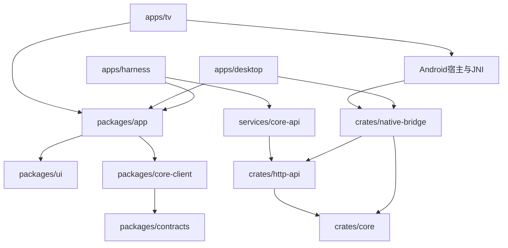

# 多端工程架构

本文维护稳定的分层、依赖、状态所有权和宿主边界；已实现／未实现看[功能台账](./feature-ledger.md)，实际通过范围看[VALIDATION](./VALIDATION.md)，开发顺序看[实施路线](./implementation-roadmap.md)。早期提案与阶段记录见[历史快照](./history/2026-11-15/ARCHITECTURE.md)。

## 核心决策

一个仓库、pnpm／Cargo 两套工作区、Desktop／Android TV 两个产品入口，外加一个不发行的验收宿主。NSH TSX负责界面，Rust负责内容、账号、媒体及持久化；目标产品的正常开发、CI和发行不依赖Go。

| 边界       | 决策                                                                                     |
| ---------- | ---------------------------------------------------------------------------------------- |
| 页面与业务 | `packages/app`共享业务、导航和页面状态；平台只作必要输入与布局适配                       |
| 基础组件   | 单一`packages/ui`拥有样式、主题、图标、动效与公共交互，不复制双端控制器                  |
| 核心       | `crates/core`独立于NSH／Android／HTTP框架，以模块组织，不为每项功能新建crate或服务       |
| 验收宿主   | Rust HTTP适配层调用同一core；`apps/harness`只承载fixture与浏览器证据，不是发行端         |
| 原生       | Desktop mixed与Android/JNI调用共享native bridge；业务进程内运行，媒体字节不经TSX反复复制 |
| 编排与缓存 | pnpm scripts调用Node编排和各语言工具；复用pnpm／Cargo缓存，不增加无实际收益的任务层      |

取舍原因和替代方案见[ADR-001：Rust核心](./architecture/adr/ADR-001-rust-core.md)、[ADR-002：原生会话](./architecture/adr/ADR-002-native-session.md)。方向成立不表示所有能力已迁移或验收。

## 目录与依赖

```text
apps/desktop|tv/           薄产品入口、NSH清单与宿主装配
apps/harness/             无头浏览器验收宿主，不含Rust crate，不发行
packages/app/             页面、共享业务、导航与媒体状态
packages/ui/              公共控件、主题、图标和动效
packages/core-client/     平台无关CoreClient、HTTP/native transport
packages/contracts/      生成wire DTO及尚未迁移的兼容类型
crates/core/              内容／账号／媒体／持久化核心
crates/http-api/          HTTP路由、来源策略、OpenAPI导出
crates/native-bridge/     原生会话、取消／销毁与媒体监听
crates/updater/           独立发行清单验签／下载，不调用内容服务
services/core-api/        Tokio进程、loopback监听及关闭，只服务验收与http-preview
tooling/                  工程编排及其回归，不进入UI bundle
contracts/                OpenAPI与去敏fixture说明
docs/                     按任务导航、就近资料、ADR与历史索引
scripts/ + upstream/      迁移期旧行为参考，不进入新业务依赖
```



App／UI／Client为源码依赖，harness→API为网络调用，bridge→core为进程内调用。harness注入HTTP transport，原生入口打开生成的原生会话并注入结构化native transport；adapter共用CoreClient及错误／取消语义。原生媒体需要URL时只开放必要loopback媒体路由，业务调用不必绕回HTTP。

- `packages/app`内部分层：`src/shell/`是外壳业务组件（`DesktopShell`、`Sidebar`、`Topbar`、`TvShell`、`TvHeader`、`Navigation`、`Pages`），`src/pages/`是页面（首页另拆`src/pages/home/`的Hero、续播、片库分段），`src/store.ts`持有导航、请求与页面状态；外壳与页面只组合`packages/ui`控件，不自行封装控件。
- 入口仅负责mount、配置和平台能力注入；共享包不反向导入`apps/*`，不在模块顶层启动宿主。
- UI不请求业务接口；core-client不依赖NSH、Node或宿主生成模块。原生Session的实际打开／关闭由装配层拥有。
- contracts只承载wire DTO，不包含UI状态或接口实现。TS包使用`workspace:*`和有限源码exports，禁止跨包深层导入。
- Node仅进入tooling等工程环境；NSH及原生导出只进入对应UI／宿主层。边界由Oxlint和工程反例测试检查。
- Rust成员共享根锁文件，mixed runner的实际依赖解析与宿主打包必须核验；cargo metadata或pnpm安装成功均不代表运行兼容。

## 页面与持久状态

每次挂载独立创建store、NavStack、查询／library资源与来源Map；不在模块级共享导航或账号可变状态。页面草稿、浏览季、媒体身份、来源和焦点分别拥有，较新操作取消旧请求，迟到响应不能覆盖当前意图。

列表使用稳定身份和ID＋offset锚点，返回先恢复位置，再在当前行恢复有效焦点；来源失效回退可用入口。覆盖页保留必要布局但退出焦点候选，避免虚拟列表回收后丢失上下文。

Rust拥有持久历史和目标账号状态，TSX消费已提交快照并派生显示。实际开始播放后才串行保存紧凑进度DTO，验证owner和媒体revision；浏览、准备失败、未加载媒体不写观看记录。删除／清空、旧checkpoint失效、关闭排空与部分失败由同一所有者协调，详情或评论不进入历史载荷。具体不变量见[历史存储](../crates/core/src/library/README.md)和对应活跃变更。

游客／账号的会话、存储与缓存隔离是账号迁移前提。持久状态迁移尚未全部完成，不能从bridge已接通或兼容入口存在推断账号可用；实现缺口只维护在台账。

## 两端装配与验收宿主

`desktop`／`tv`是产品端型，不由OS名称推断。host以输入、窗口、外链、更新和媒体等实际能力描述环境。播放器只有出现第二种真实实现时才提取必要接口，不预建空适配层。

| 端         | 核心与宿主责任                                                                                |
| ---------- | --------------------------------------------------------------------------------------------- |
| Desktop    | NSH mixed链接core，拥有初始化、平台私有数据、窗口、后台任务、关闭和更新                       |
| Android TV | Android native library／JNI与NSH embedding，拥有遥控／媒体键、输入、surface及Activity生命周期 |
| 验收宿主   | 浏览器引擎内跑同一`packages/app`，连fixture或Rust HTTP API；只产出证据，不发行                |

网络、数据库和媒体解析不阻塞UI线程；异步runtime由服务／宿主统一拥有，不为每个会话无限创建线程或runtime。请求、播放会话、回调和写队列都有取消／关闭顺序，重复关闭幂等。

原生媒体监听随机loopback端口，保留Host／Origin、会话授权、路径和Range校验；URL由核心生成，不接受任意外部scheme／host。核心与宿主共享进程，不能靠重启sidecar隔离故障；解析边界、fuzz及FFI必须覆盖panic和资源释放。

`services/core-api`只监听loopback，为验收宿主与原生`http-preview`提供同一HTTP契约，不是可公网部署的服务。它仍按认证用户实例化独立上下文：即使多用户共享一个进程，也不能共享单账号全局状态，因为多条验收会话会同时连同一实例。

TV独立运行不依赖电脑API或adb reverse。默认native、显式HTTP preview与T0的选择及命令见[运行手册](./development.md#运行模式与数据)。初始化／停止、后台／恢复、JNI所有权、遥控返回／焦点、解码和安装包分别验收。MVP 的 TV 验收宿主是固定 API34 AVD 模拟器，模拟器注入的遥控与输入属于验收范围；物理电视、硬解与 4K 按平台限制记录，不能用模拟器结果宣称为物理设备通过。webOS／Tizen／tvOS不因共享仓库自动获得支持。

Android TV／盒子复用 packages/app 与 packages/ui；Android adapter 拥有输入、媒体 surface、系统安装与生命周期。Desktop／TV 共用 Rust 核心和 native bridge，不新增 TV 业务副本、Go 子进程或第二套状态机。最低运行范围 API26，target SDK 与渠道要求单独管理；arm64 是首批目标，armv7 须在可构建且真实 32 位运行环境验收后才声明支持。固定工具链、版本、ABI 与构建入口归 [Android 宿主](../apps/tv/android/README.md)，不在架构层复制一张易漂移的版本表。

APK 内受限 loopback 媒体路由不是电脑 API 依赖；独立验收时电脑 API 停止、reverse 为空，不能清库绕过失败。

## 契约、数据与安全边界

Rust HTTP DTO和路由是OpenAPI／TypeScript wire types的唯一编辑源；生成结果提交并检查漂移。NSH原生API由真实Rust导出生成；HTTP／native共用业务用例和契约场景，未知／缺失字段、错误码、取消、超时、载荷上限、媒体路径和206／416都需覆盖。

目录查询／分页／演员／系列归catalog，播放身份／来源恢复归playback，有界媒体准备／流式读取归media，SQLite与提交快照归library。具体协议预算、状态机和资源生命周期在相应模块README／代码／活跃spec维护，不在总架构复制一份早期实现数值。

数据库有明确版本、原子提交和备份恢复；损坏／不兼容拒绝初始化，不读旧客户端JSON、不删除数据绕过错误。阻塞SQLite操作放在专门执行上下文；失败不发布已提交快照。HTTP binary显式接受数据目录，原生使用平台私有目录。

FFI／JNI定义分配／释放方、线程、回调注销、取消与幂等销毁。Rust panic不跨ABI，裸指针不进入页面状态；只有必要FFI模块可包含经审查的unsafe。密码学使用维护中的库，不自行实现底层算法。

配置分为产品默认、机器环境和临时连接；随机端口、绝对开发路径、凭据及`.nsh/`、runtime配置、缓存、截图不入库。每入口默认单会话；支持并行前先隔离生成／运行目录。源码交付只在主项目，临时目录仅作缓存和可再生产物。

## 迁移与退出条件

上游只提供固定源码行为与去敏向量，不进入新产品链接、编译或正常CI。原Node网关的来源／路由／Range／断开行为转为Rust测试；旧TSX行为由共享app保留，不复制另一套旧界面。用户排除的社交能力不列迁移缺口。

每项迁移同时核对真实能力、现有UI、契约与生命周期；默认合成回归保障边界，正式入口真实流程证明功能，具体执行以ENGINEERING和实施路线为准。稳定架构不承担逐批完成状态。

旧链路退役前，必需行为由Rust／新入口覆盖，原harness／macOS真实观看／历史回归、目标安装包及适用平台验收完成；移除旧启动／构建和Go检查依赖后，在无Go干净环境执行setup、verify与发行构建。未达到门槛时保留明确缺口，不用目录存在或脚本返回0代替退出条件。
