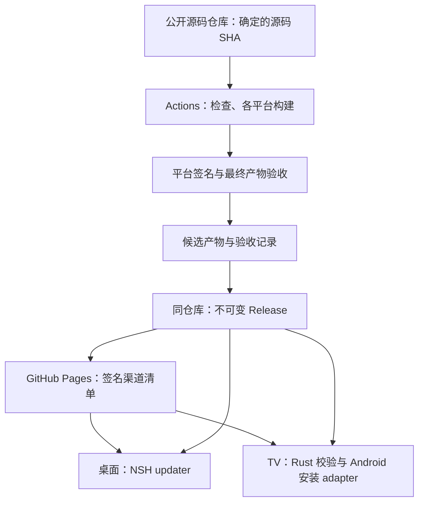

# GitHub 构建、分发与自动更新方案

调研日期：2026-11-13。状态：R0 基础与 R1 预览基础已实施，正式候选与设备升级仍未实施。依据当前工作区、固定 NSH 0.5.0（f4d68f7）、本地 CLI/生成类型及官方资料；本文不代表远端流水线、正式签名或设备升级已经通过。

## 1. 建议采用的方案

按已确定的源码公开方向，使用 `bijinfeng/hongguo-tv` 一个公开仓库承载源码、构建与发行。GitHub Actions 构建与签名，同仓库 Releases 存放不可变安装包，GitHub Pages 提供按端、按渠道隔离的签名更新清单。客户端不需要 GitHub 账号或 token，不新增独立发行仓库或跨仓库凭据。

桌面复用 NSH 整包更新；Android TV 由应用的 Android 宿主下载完整 APK、校验并调用系统安装器。两端共享更新入口、显示状态和交互规则，平台 adapter 负责安装。首期只启用 stable 整包更新，不做差分包、TSX OTA、百分比灰度或自建更新服务。

TV 的“自动更新”定义为自动发现版本、按用户设置下载、由用户确认系统安装。普通侧载应用不承诺全程静默安装。桌面下载后也由用户选择重启时机，避免打断观看。



源码公开是已确定的方案前提；本次复核远端已返回 PUBLIC。Pages、生产签名和正式发布配置仍留待实施阶段。

## 2. 当前能力与缺口

| 项目     | 已核对的实现                                                                                     | 对本方案的影响                                                                                |
| -------- | ------------------------------------------------------------------------------------------------ | --------------------------------------------------------------------------------------------- |
| GitHub   | `gh repo view` 复核返回 PUBLIC，默认分支 `master`                                                | 公开源码、同仓库发行；不依赖改名为 main，客户端无 token                                       |
| 现有 CI  | `.github/workflows/ci.yml`：三系统 Rust、macOS 三端 NSH check/build/headless、security、required；`release-validation.yml`：确定 SHA 的源码验证；`release-preview.yml`：macOS arm64 与 TV T0 预览 | 尚无正式发行、桌面安装/升级或 TV Android 构建发布 job；配置存在不等于远端已通过 |
| NSH      | `.nsh-version` 为 0.5.0；本机 CLI 为 f4d68f7；生成类型包含 `nsh/updater`                         | 可复用原生整包更新 API，无须引入 Electron/Tauri 更新框架                                      |
| 桌面     | `apps/desktop/nsh.json` 无 native crate、无 updater；当前 package 命令要求外部 API               | 目前只能分发显式标记的预览包，独立产品需完成 Rust 业务内嵌                                    |
| TV       | 自有 `NshView` embedding 宿主；`packageTvHost()` 执行 `assembleDebug` / `lintDebug`              | 给 NSH 命令加 keystore 参数不足以完成生产签名，最终 Gradle 宿主也必须有 release signingConfig |
| TV APK   | arm64-v8a、min 26 / target 35；当前 T0 使用 debug 签名                                           | 正式包需固定身份、正式 keystore；不能把 T0/debug 包当作正式升级起点                           |
| 业务     | 匿名目录与游客历史在 Rust；账号、真实播放与原生业务桥接未完成                                    | 构建通道可先建立；正式产品发行不得绕过业务与独立运行验收                                      |
| 版本     | 根 package.json 和三端 nsh.json 分别声明 0.1.0，各端 build 为 1                                  | 建立唯一产品版本源，避免包版本、APK versionCode 和清单漂移                                    |
| 安全门禁 | VALIDATION 记录 NSH 间接依赖许可证及停止维护 advisory 导致 security 失败                         | 是已记录的发行阻塞，本次未重跑；不能在发行工作流中忽略或删除该检查                            |

现状依据：README、ARCHITECTURE、ENGINEERING、DESIGN、VALIDATION、TV_DEVELOPMENT，以及 `tooling/src/cli.mjs`、`tooling/src/tv-host.mjs`、`tooling/src/release.mjs`、TV Gradle/manifest/Activity。并行中的界面修改不属于本方案实施。

## 3. 调研结果与方案取舍

### GitHub 的职责

| 能力                 | 用途                             | 边界                                                                                             |
| -------------------- | -------------------------------- | ------------------------------------------------------------------------------------------------ |
| Actions              | 可重复构建、检查、签名、产物晋级 | 公开仓库的标准 GitHub-hosted runner 免费；larger runner 另行计费                                 |
| Actions artifacts    | PR 预览、候选、测试报告、符号    | 下载需要登录和仓库读取权限，且有保留期限；公开仓库 artifact 不是保密存储，不适合作为产品更新 URL |
| Releases             | 用户安装包和版本证据             | 公开仓库才能匿名下载；每个资产须小于 2 GiB                                                       |
| Pages                | 下载入口与小型签名清单           | APK/桌面归档不放 Pages；站点有大小、带宽与用途限制                                               |
| Release immutability | 固定已发布标签与资产             | 必须先补齐草稿资产再发布；不能覆盖原文件修复坏包                                                 |

依据：[Releases](https://docs.github.com/en/repositories/releasing-projects-on-github/about-releases)、[Artifacts](https://docs.github.com/en/actions/how-tos/manage-workflow-runs/download-workflow-artifacts)、[Pages 限制](https://docs.github.com/en/pages/getting-started-with-github-pages/github-pages-limits)、[不可变发行](https://docs.github.com/en/code-security/concepts/supply-chain-security/immutable-releases)、[Actions 计费](https://docs.github.com/en/billing/concepts/product-billing/github-actions)。

源码公开后优先使用标准 GitHub-hosted runner，降低构建计算成本；larger runner、存储超额和平台签名服务仍需单独核算。先记录一次完整矩阵的时间、产物体积与实际费用，再设预算。预览 artifact 建议短期保留，正式候选必须覆盖完整验收周期；符号按对应版本长期归档，可去敏后随公开发行提供。共享依赖缓存按 OS/架构/工具链/锁文件隔离，不能缓存签名材料来节省构建时间。

### 为什么使用 Pages 清单

固定版本的 [`nsh-updater` 源码](https://github.com/longbridge/nsh/blob/f4d68f7/crates/nsh-updater/src/lib.rs) 已核对：

- `updater.github` 固定访问 `https://github.com/<owner>/<repo>/releases/latest/download/latest.json`，不调用 REST API。
- 一份清单只有一个 `id`；桌面和 TV 当前分别是 `dev.hongguo.desktop`、`dev.hongguo.tv`。
- 即使配置自定义清单文件名，签名仍固定解析为同目录的 `latest.json.sig`。在一个 Release 中把两端清单改名，不能直接解决签名冲突。
- 整包更新比较 SemVer，只有更高版本才会提供；同版本只增加 build 不能让桌面收到整包更新。

| 方案                                     | 评价                                                                           |
| ---------------------------------------- | ------------------------------------------------------------------------------ |
| 一个公开仓库 + 直接设置 `updater.github` | 单应用 ID 很简单；本项目的多 ID、渠道和停止投放需求不适配                      |
| 每端一个公开发行仓库                     | 可行且无需 Pages，但增加仓库和跨端发行管理；可作为不启用 Pages 的备选          |
| 公开源码仓库内发行 + Pages 分目录清单    | **推荐**；源码、tag、产物与流程同仓库，保留两个应用 ID，不改 NSH，无跨仓库授权 |
| 自建更新服务/CDN                         | 网络规模或投放策略有实际需求后再引入                                           |

REST 匿名请求通常受每个来源 IP 每小时 60 次限制，因此客户端不轮询 Releases REST API。本方案使用静态清单，但静态托管仍可能限流或不可达。见 [GitHub REST 限额](https://docs.github.com/en/rest/using-the-rest-api/rate-limits-for-the-rest-api)。

### NSH 更新能力

桌面直接使用生成类型中已有的 `checkForUpdate()`、`downloadUpdate()`、`installAndRestart()`；`canInstall=false` 时提供已验证的手动安装链接。开发运行返回 null，不能通过 `pnpm dev:desktop` 证明更新可用。系统管理或不可写安装位置需要手动安装，不自动提权。

Android 的 `canInstall` 为 false，内置 updater 不负责下载/安装 APK。TV 当前还是自有 embedding 启动流程，不能把“NSH 官方打包支持 OTA”推定为这个宿主已经接好 OTA launcher。

纯 TSX OTA 不能更新 Rust、JNI、运行时或 Android manifest，并增加原生 bridge 兼容版本、信任根、冷启动与回退矩阵。首期不配置 `updater.packages`，后续有实际发版频率收益再评估。

依据：[App Updates](https://nsh.dev/docs/app-updates/)、[OTA Updates](https://nsh.dev/docs/ota-updates/)、[Signed Packages](https://nsh.dev/docs/signed-packages/)；API 以本项目 `apps/desktop/.nsh/types/nsh/updater.d.ts` 与固定源码为准。

## 4. 仓库、清单与版本

### 单仓库源码与发行

源码、版本文件、工作流和发行记录均保留在当前仓库。公开 Release 的自动源码归档直接对应产品源码 tag，用户可定位并复现构建。安装包仍通过 Release 资产提供，Pages 只部署下载入口与更新元数据，不复制或发布整个源码目录。

公开前核对现有 Git 历史、日志和 artifact 的凭据/私人数据，并明确项目 LICENSE 与第三方 NOTICE；不将“源码可见”当成已经具备明确开源许可。公开后的日志、artifact、符号和 source map 以可被外部读取为前提，只上传已去敏内容；生产密钥始终留在受保护的 environment secrets。

建议静态站点路径如下；Pages 尚未启用：

```text
https://bijinfeng.github.io/hongguo-tv/
  index.html
  desktop/stable/latest.json
  desktop/stable/latest.json.sig
  tv/stable/latest.json
  tv/stable/latest.json.sig
```

首期只生成 stable。后续预览渠道使用独立 `.preview` 应用身份、预览签名和 `/desktop/preview/`、`/tv/preview/` 目录；不能让预览包覆盖正式应用或修改 stable。PR artifact 与公开预览包都不能存放保密测试数据；确有保密需求时另用受限存储，不把“尚未正式发布”当成私有。

桌面配置模板如下，值在实施时由发布配置生成；这里不修改现有 manifest：

```json
{
  "updater": {
    "url": "https://bijinfeng.github.io/hongguo-tv/desktop/stable/latest.json",
    "publicKey": "<正式更新清单 Ed25519 公钥>"
  }
}
```

清单中的每个安装包 URL 必须为带确定 tag 和资产名的完整 HTTPS Release URL，不能相对 Pages 解析，也不能指向 `/releases/latest/`。发布站点不转换签名清单的空白、换行或编码。

渠道更新先发布 Release、匿名检查所有资产，再整体部署站点；不在包尚不可下载时暴露清单。Pages 发布失败时保持上一个渠道版本，重试只能晋级同一组已验收哈希。并发发布按渠道串行，旧任务不得覆盖新版本。

清单与签名是两个 HTTP 请求，缓存切换时仍可能短暂读到不同版本。必须验签失败关闭、保留当前应用并有限重试，不能临时接受无签名清单。首个桌面升级实验需专门验证固定 NSH 的缓存/重试行为；不满足时先加宿主适配，不改框架。

### 版本与发行身份

拟新增根级 `product-version.json`，包含 `version` 和 `build`，作为唯一编辑源。工程脚本同步现有 NSH 清单、根产品版本和 Android versionName/versionCode，`version:check` 拒绝漂移。命令名为拟议接口，当前尚不可执行。

- 正式版本使用 SemVer `x.y.z`，每次整包发行都增加版本；修复包不能仅增加 build。
- build 为全局单调递增正整数，作为 Android versionCode；校验 Android 可用范围，不直接把 workflow run number 当版本。
- 产品 tag `vX.Y.Z` 指向构建候选的源码 SHA，同仓库 Release 绑定该 tag；不另建发行仓库 tag。
- `release.json` 记录 sourceRepository/sourceSha、version/build、工具链、平台资产 SHA256/大小、签名身份、run ID 与验收记录标识；渠道发布结果另记录 Pages deployment ID。
- 首次生产发行前确认两个正式应用 ID、数据目录及更新公钥。保留现有 ID 是默认建议，尚未形成正式身份承诺。
- 已安装 T0/debug 签名 APK 不能直接覆盖为不同签名的正式 APK。开发身份先隔离；正式升级测试必须从生产同签名的 N-1 包开始，不以卸载正式应用修复升级。

### 资产与支持矩阵

首个发行演练优先 macOS arm64 与 TV arm64。Windows/Linux 是产品目标，必须各自完成宿主构建和升级验收后才加入正式支持，不能由三系统 Rust CI 推定。

| 平台                     | 初装文件                                    | 应用内更新资产                                                | 候选验证重点                                                       |
| ------------------------ | ------------------------------------------- | ------------------------------------------------------------- | ------------------------------------------------------------------ |
| macOS arm64，后续 x86_64 | 已签名、公证的 app 归档；需要时再提供 DMG   | NSH 识别的 `*-macos-aarch64.tar.gz` / `*-macos-x86_64.tar.gz` | Developer ID、notarization/staple、Gatekeeper、可写/不可写安装位置 |
| Windows x64              | 固定 CLI 实际支持且验收的安装程序或便携 ZIP | NSH 平台更新 ZIP                                              | Authenticode、时间戳、文件占用、安装目录权限、重启 helper          |
| Linux x64                | NSH 目录归档 `.tar.gz`                      | 用户可写目录中的 NSH 归档                                     | 动态库/系统基线；系统包管理安装不承诺自行替换                      |
| Android TV arm64-v8a     | 最终 Gradle release APK                     | 同一个完整 APK                                                | APK 签名、applicationId、versionCode、minSdk、ABI、TV 安装器遥控   |

以 NSH 实际产物名为准，统一归档显示名宜使用稳定 ASCII，避免中文/空格 URL 与脚本解析问题。macOS universal 的更新平台键映射须单独实验，不先承诺通用包。首发不额外增加 AppImage、deb/rpm、MSIX 或双播放器包矩阵。

每个 Release 同时提供 SHA256SUMS、去敏 release.json、SBOM、NOTICE 和分端更新清单的归档副本；保留目录的清单/签名可打成 `update-metadata.tar.gz`，Pages 使用其中的原始字节。调试符号和源码映射按版本归档，公开提供前确认不含凭据、私人路径或测试数据。

## 5. 构建与发布流水线

现有 CI 保留，新增真实 Android 构建/模拟器以及各桌面宿主 job；接通的产品目标纳入 required。工程入口沿用 pnpm/Cargo，不新增 Go 发行依赖。干净 runner 执行 frozen install、setup、setup:tools、doctor、verify；发行另外执行 security、包检查和安装/升级验收。缺工具、缺报告、缺平台或安全失败都应阻止正式晋级。

| 工作流（拟新增）                        | 触发与权限                                                                    | 交付                                                  |
| --------------------------------------- | ----------------------------------------------------------------------------- | ----------------------------------------------------- |
| `release-validation.yml`（同仓库）      | 手动选择确定 SHA；验证源码版本、完整公共门禁和元数据契约，不拿生产密钥       | 可追溯的源码验证记录；不产生可安装候选，不投放 stable |
| `release-preview.yml`（同仓库）         | 手动选择确定 SHA；构建 macOS arm64 预览包和 TV T0 APK，不拿生产密钥          | 短期 Actions artifact、`release.json` 和 `SHA256SUMS`；不投放 stable |
| `release-candidate.yml`（后续，同仓库） | 默认分支上的确定 SHA，受保护 tag 或显式输入；平台产物构建后才进入受控签名阶段 | 最终签名候选、SBOM、完整验收记录；不自动投放 stable   |
| `publish.yml`（后续，同仓库）           | 指定候选 run ID、源码 SHA、version/build、资产摘要；受保护环境审批晋级        | 上传并验证草稿 → 发布不可变 Release → Pages 指针晋级  |

版本必须先写入源码再形成候选。tag 先建或后补均需校验指向同一 SHA，禁止发布时自动重构建。候选过期、文件缺失、重签名或字节变化必须重新验收。正式标记前最终文件需完成平台验签及安装冒烟。

候选验收后，未来的 `publish.yml` 读取同仓库的确定 run ID 和去敏验收记录，校验运行来源、workflow、源码 SHA、版本与产物摘要，再将同一批文件上传至草稿。不能只按 artifact 名称查找“最新成功构建”，也不能把任意 fork PR 的 artifact 当成可签名/可发布候选。GITHUB_TOKEN 按 job 分配所需权限即可完成同仓库晋级。

顺序约束：

1. 检查版本唯一性、源码/tag、锁文件、门禁和候选身份；仓库配置定义本次必需平台集合。
2. 各平台原生 runner 构建，生产签名完成后形成候选。macOS 公证/装订、Windows 签名/时间戳、TV 最终宿主 release 签名都在最终摘要之前完成。
3. 安装这些最终文件，执行 N-1 → N 升级、数据兼容与观看恢复；人工 TV 真机证据绑定 APK SHA256。
4. 由最终文件计算摘要，生成并签名清单；验证清单签名、包摘要、版本和平台身份。
5. 上传公开草稿的完整资产，从 GitHub 下载回验；发布后匿名复验，再部署 Pages。
6. 保存渠道部署 ID、源码 SHA、资产摘要与验证报告。复跑同候选必须幂等；同版本不同哈希直接失败。

构建 runner 与生产签名阶段分离权限；不让 fork PR、任意 workflow_dispatch ref 或不可信缓存进入签名路径。签名阶段执行的工具与 workflow 也必须来自审核过的固定提交。Actions 固定完整 SHA，不在 `pull_request_target` 执行 PR 代码。[GitHub Actions 安全依据](https://docs.github.com/en/actions/reference/security/secure-use)。

### 凭据与审批能力

同仓库操作使用短期 GITHUB_TOKEN，不新增 GitHub App 或 PAT。默认 `contents: read`，读取候选的 job 按需加 `actions: read`，Release job 加 `contents: write`，Pages deploy job 加 `pages: write` 与 `id-token: write`；不把写权限提升到所有构建/PR job。客户端只携带公钥。[官方鉴权说明](https://docs.github.com/en/actions/tutorials/authenticate-with-github_token)。

GITHUB_TOKEN 触发的常见仓库事件不会再次启动工作流，因此不能依赖发布 Release 的事件自动接力部署 Pages。`publish.yml` 直接编排 Release 发布与后续 Pages job，或者调用同仓库 reusable workflow；二者共享经校验的同一组资产和清单。见 [工作流事件触发规则](https://docs.github.com/en/actions/how-tos/write-workflows/choose-when-workflows-run/trigger-a-workflow#triggering-a-workflow-from-a-workflow)。

更新清单私钥与 macOS/Windows/Android 代码签名密钥分开，备份、责任人与轮换流程分别记录；签名材料临时落盘后清理，不进缓存或 artifact。清单签名保证更新来源，系统代码签名保证安装身份，GitHub 来源证明保证产物出处，三者不互相替代。单公钥 NSH 配置的密钥轮换需先用旧密钥发布信任新公钥的宿主，不能直接更换线上清单签名；旧密钥丢失/失陷有必须手动安装的恢复边界。

公开仓库可配置 environment required reviewers。设置独立的 `release-signing` 和 `production` 环境：前者保护生产签名密钥，后者保护正式发行与 Pages 投放；仅允许已审核的分支/tag，按维护者配置防止自行批准及管理员绕过。签名 job 也必须在获得对应审批后才拿到密钥，不能只保护最后的发布步骤。单维护者阶段若无法提供独立审批人，应如实记录审批配置，不以 environment 名称冒充双人复核。若未来调整仓库可见性，再按账号套餐重新确认保护能力。见 [部署保护与套餐限制](https://docs.github.com/en/actions/reference/workflows-and-actions/deployments-and-environments)。

## 6. 双端更新实现边界

### 共享层与宿主层

拟在 `packages/core-client` 定义平台无关 `UpdateClient` 端口，`packages/app` 负责共享更新用例和显示状态，`packages/ui` 提供已有主题下的控件。`apps/*` 只装配能力，不复制一套更新页面。

端口拟包含 `check`、`download`、`install`、状态订阅与 dispose；能力描述区分 `restart`、`system-confirmation`、`manual`，不以 OS 判断 TV。接口实现时以实际 NSH 类型/JNI 能力生成契约，不把这些拟议方法当成现有框架 API。

- 桌面 adapter 包装 `nsh/updater`。下载缓存、替换和 helper 归宿主；TSX 镜像状态，不自写安装逻辑。
- TV 更新校验/下载逻辑放一个独立的 Rust 应用更新模块或 crate，通过原生 bridge 暴露；不塞进内容协议 core。Android adapter 只负责权限、安装 session、系统 intent 和实际包信息。
- 更新结果、下载文件和安装 attempt 由原生侧拥有，页面只有短期交互状态；跨页面不重复下载，应用退出取消/恢复有界。
- Web 不暴露安装更新入口；源码变化后的 Web 部署是另一条交付链。

### 桌面流程

后台检查 → 有可用版本 → 用户下载（可选以后启用自动下载）→ 下载验证完成 → 用户选择“重启更新” → 暂停播放、确认保存进度、释放数据库/媒体资源 → NSH 替换与重启 → 新版本确认。

下载后到安装前，串行绑定同一个更新对象，不能另一次 check 把当前下载目标替换成另一个版本。退出前进度保存失败需留在当前版本并允许重试，不悄悄丢历史。替换失败保留旧程序；NSH 的替换失败保护不等于新版本启动后崩溃自动回滚，后者首期通过验收和更高版本修复包处理。

macOS 正式发行需遵循 [Apple 公证流程](https://developer.apple.com/documentation/security/notarizing-macos-software-before-distribution)，Windows 使用 [SignTool 签名与验证](https://learn.microsoft.com/en-us/windows/win32/seccrypto/signtool)。最终归档必须包含已签名的程序；签名后重新归档再重新计算摘要。

### TV 清单与完整 APK 安装

固定 CLI `nsh update-manifest --link android=...` 只生成链接，没有 APK 的 hash、size、versionCode 等。TV 必须新增完整制品清单生成/校验，不能直接把这个参数当作安全 APK 更新实现。

建议沿用 NSH 清单的 `id/version/notes/platforms.android` 外壳，顶层增加 `schemaVersion: 1`、`channel: stable`，android 资产增加 `sha256`、`size`、`versionCode`、`packageName`、`minSdk`、`abis`、`signingCertificateSha256`。这是本项目扩展，不是 NSH 内置 APK 安装支持。首发只列 arm64；需要多 ABI 时先设计选择规则再扩展，不能靠 URL 猜 ABI。

所有扩展字段必须在签名前写入，TV 对完整原始清单验签后再解析；发布端和 TV 原生侧优先复用固定版本 `nsh_updater::sign/verify`，不自创签名格式。签名使用 NSH 的上下文前缀和 Ed25519，不能只对 JSON 单独签名。实现阶段用共享向量验证发布端与客户端互通、篡改拒绝和未知 schema 拒绝。

安装步骤：

1. 校验清单签名、应用 ID、渠道、schema、SemVer 和大于已安装值的 versionCode；对同版本修包也要求产品版本递增。无新版本与检查失败分别返回。
2. 将 APK 流式下载到应用私有临时目录；校验 HTTPS、可信下载来源/重定向策略、大小上限与可用空间。允许 GitHub 实际资产跳转，但拒绝降级 HTTP 和非预期来源。校验失败删除临时文件；取消和断网保留当前安装。
3. 对完整文件验证 SHA256、精确大小、APK 包名、versionCode、minSdk、ABI 以及正式签名身份。首发要求固定完整 signer 集合匹配，不用“任意一个证书匹配”放宽；旧 Android 的 API 差异由 adapter 处理。证书轮换另行设计 lineage 与设备矩阵。
4. 用户选择安装后，检查 `canRequestPackageInstalls()`，必要时引导到该应用的未知来源授权，再返回同一更新流程。声明所需 `REQUEST_INSTALL_PACKAGES`；不申请系统特权，不要求 root/ADB。
5. 使用 PackageInstaller session 写入并 commit，处理 `STATUS_PENDING_USER_ACTION`；用户在系统安装器确认。API 26 到目标设备系统分别适配回调和 PendingIntent 要求。
6. 记录提交的目标版本与摘要；系统成功回调及下次冷启动的实际安装版本共同确认结果。拒绝/取消/空间不足均允许重试，启动安装器本身不算安装成功。

如厂商安装器与 session 方案不兼容，才评估内容 URI + 临时只读授权的系统安装 intent 回退；FileProvider 只暴露该更新文件，不开放整个目录。系统安装界面的可遥控性必须逐设备确认。

Android 的无人值守更新有安装者身份、权限和目标版本等条件，本产品不以这些条件为首发保证。依据：[安装 session 条件](<https://developer.android.com/reference/android/content/pm/PackageInstaller.SessionParams#setRequireUserAction(int)>)、[未知来源权限](<https://developer.android.com/reference/android/content/pm/PackageManager#canRequestPackageInstalls()>)、[用户确认回调](https://developer.android.com/reference/android/content/pm/PackageInstaller#STATUS_PENDING_USER_ACTION)、[应用签名与升级身份](https://developer.android.com/studio/publish/app-signing)。

### 更新体验

在关于/设置中提供“检查更新”；自动检查成功发现版本后只显示轻量提示，不夺走播放或输入焦点。首次启动延迟检查、之后最多每 24 小时自动检查一次并加随机抖动；手动检查可立即发起但需防重复请求。此频率是产品建议，不是 GitHub 或 NSH 保证。

初版默认自动检查、用户决定下载；可在完整取消/网络测试后启用“自动下载”。显示当前版本、可更新版本、必要的变更说明与下载进度即可，SHA、签名和流水线信息放诊断日志。下载总量未知时不显示虚假的百分比。

共享状态语义：`idle → checking → available → downloading → ready → installing`，另有 `upToDate`、`awaitingPermission`、`awaitingConfirmation` 和可恢复错误。返回页面不丢下载状态；TV 返回/取消恢复原焦点；不会把失败当成“已是最新”。桌面未有真实取消 API 时不显示虚假的取消下载按钮，TV 取消由原生实现。

交互复用现有 NSH 语义控件、主题和减少动态效果规则。动效只用于状态进入，进度与焦点即时更新；实施前补 DESIGN 动效清单，完成后在桌面/TV 真实宿主观察深浅主题、键盘/遥控、焦点和系统安装界面。更新交互已另行制作浏览器原型，见 [更新 UI 规格](design/update-ui.md)。原型覆盖模拟状态与输入，不代表真实 NSH/Android 更新能力已接入或验收。

## 7. 故障、撤回与数据

| 故障                                | 行为                                                                        |
| ----------------------------------- | --------------------------------------------------------------------------- |
| GitHub/Pages 不可达、超时、限流     | 保持当前版本可用；有界退避，手动重试；不影响正常观看                        |
| 缓存清单与签名不一致、签名错误      | 拒绝更新，记录不同错误原因；绝不降为无签名下载                              |
| 下载中断、空间不足、包不匹配        | 不进入安装；保留旧应用，清理失败临时文件，提供重试                          |
| TV 未授权、用户取消或厂商安装器拒绝 | 返回原应用，保留可重试状态；不要求卸载或清数据                              |
| 正式发布后发现严重问题              | Pages 撤回该版本的投放，保留不可变资产和证据；以更高 version/build 发布修复 |
| 二进制启动后故障或迁移失败          | 使用已验证的数据备份/恢复路径；不能依赖 NSH 安装失败保护解决启动后逻辑错误  |

撤回时将渠道清单恢复为上一份已验签清单，阻止较旧设备继续获知坏版本；已缓存/下载或离线设备无法被保证立即撤回，已安装坏版本也不会自动降级。若要实时 kill switch 或防重放 freshness，需另行扩展清单和客户端；首期不承诺。

数据库迁移前备份，升级中断、磁盘满、未来 schema、迁移失败保留原数据；测试历史和账号保留，但不读取旧参考客户端数据。不把复制旧二进制等同于数据可回退，不用删除数据库处理更新错误。

单 GitHub 通道能满足首期托管与分发，但不保证所有电视网络可达。发行前从目标地区的桌面与家庭电视网络测量清单和 Release 跳转下载。若成功率或速度不满足产品要求，再接自有域名/CDN；镜像使用同一套签名清单和哈希，不引入任意第三方 GitHub 加速代理。

## 8. 实施顺序与退出条件

以下为实施边界与退出条件；已落地项目单独在本节末记录。

| 阶段               | 交付                                                                                                  | 退出条件                                                                                     |
| ------------------ | ----------------------------------------------------------------------------------------------------- | -------------------------------------------------------------------------------------------- |
| R0：发行基础       | 公开现有源码仓库、明确 LICENSE/NOTICE、启用同仓库 Pages、应用身份、唯一版本源与受控签名路径           | 干净 checkout 版本检查可复现；源码/历史可公开，客户端无 token                                |
| R1：构建和预览     | 源码验证 workflow、macOS arm64 桌面预览与 TV arm64 T0 预览 workflow、版本/摘要/校验和工具；正式签名仍待接入 | 当前只产生短期 Actions artifact；正式候选仍需从 GitHub 下载原文件可安装，不能因业务未完成误发正式版 |
| R2：桌面更新闭环   | shared UpdateClient、桌面 NSH adapter、签名 Pages 清单                                                | 真实安装包 N-1 → N、重启保存、错误签名/断网/权限路径通过；macOS 优先，其他系统独立验收       |
| R3：TV 更新闭环    | Rust 清单校验/下载、Android 权限/session adapter、共享 UI                                             | 同签名 N-1 → N 保留数据，拒绝错包/错证书/降级；模拟器与目标真机安装器分别通过                |
| R4：正式晋级与恢复 | 不可变 Release、渠道串行晋级、停止投放/修复包演练、设备证据                                           | 最终签名资产满足业务、security、独立运行和真机门禁；公开匿名下载与升级复验通过               |

R0/R1 可与 Rust 业务迁移并行；R2/R3 可用明确标记的测试版本验证更新机制。正式产品发布仍依赖 TV_DEVELOPMENT 中真实观看闭环、独立客户端和首发验收，不以更新机制通过替代。

`tooling/src/release.mjs` 已提供 `check`、`sync`、`metadata` 和 `record` 命令，输出稳定 JSON 摘要和明确退出码，使本地、CI 和 Agent 走同一路径。`record` 生成不含本地路径的候选 `release.json` 与 `SHA256SUMS`，并拒绝非 HTTPS URL、重复 target、非法 Git SHA、缺失产物和不完整描述。报告包含 `sourceSha/version/build/target/artifactSha256/signingIdentity`；签名、网络、设备与业务问题仍由后续候选门禁分别报告。

关键验收至少覆盖：

- manifest 篡改、错误公钥/应用 ID/schema、缺哈希、错大小、错误平台；发布端与客户端签名向量互通。
- 源码/tag/版本不一致、缺必需平台、同版本不同哈希、过期候选、并发旧发布覆盖、Pages 失败后的幂等重试。
- 桌面可写/不可写安装、下载中断、文件占用、退出保存失败、重启实际版本与数据库迁移恢复。
- TV 未授权/授权返回、系统取消/失败、进程被杀、断网/空间不足、错误签名/ABI/minSdk、N-1 覆盖升级及重启保留历史。
- 更新时不打断播放、不抢焦点；键鼠和遥控均能完成，深浅主题与系统安装页面实际观察。
- CI 不能访问生产密钥的反例、缺工具失败、无 Go 的构建；保持现有 hooks 的部分暂存保护。

## 9. 本次已验证与仍未验证

本次完成只读源码/配置核对、GitHub 仓库可见性查询、官方资料调研，并用本机固定 CLI 做了临时离线实验：

1. `nsh update-manifest` 对合成桌面文件生成含 URL、SHA256、size 的清单与签名；Node 内置 crypto 按 NSH 上下文验证签名成功，修改一个字节后拒绝。
2. 同 CLI 的 Android `--link` 实际只生成 URL，证实不能直接承担完整 APK 校验清单。
3. 配置 publicKey 却不传签名 key 时，CLI 明确失败。

合成文件不是可安装归档；临时测试密钥和文件均已删除。以上实验只证明清单工具和签名格式，不证明下载、安装或升级行为。

本轮已确认远端为 PUBLIC，加入 `release-validation.yml`、`release-preview.yml`、唯一版本源检查、候选产物记录工具和对应测试；未修改 GitHub 设置、上传资产、部署 Pages、接入正式签名或修改应用更新宿主。`pnpm verify` 已通过；`pnpm security` 仍需单独处理已有依赖策略阻塞。正式签名、跨系统更新、TV 真机、网络可达性、Android 宿主 OTA、安装失败后的真实恢复均尚未验证。
